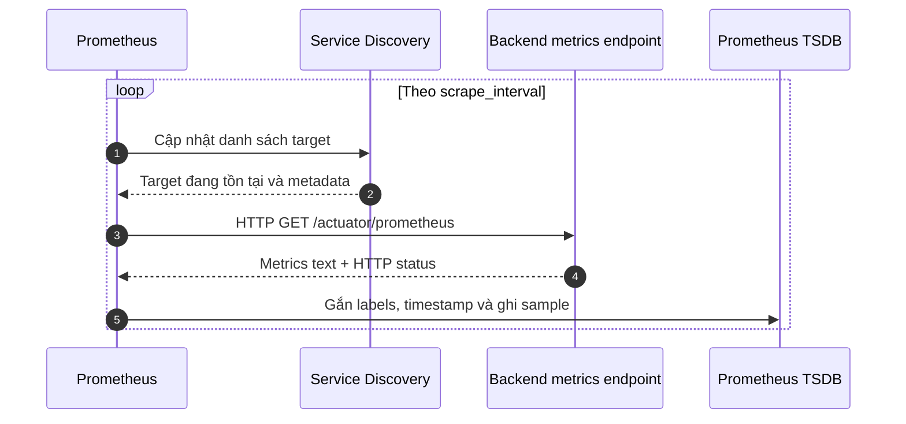
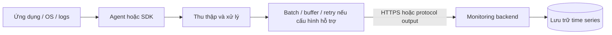
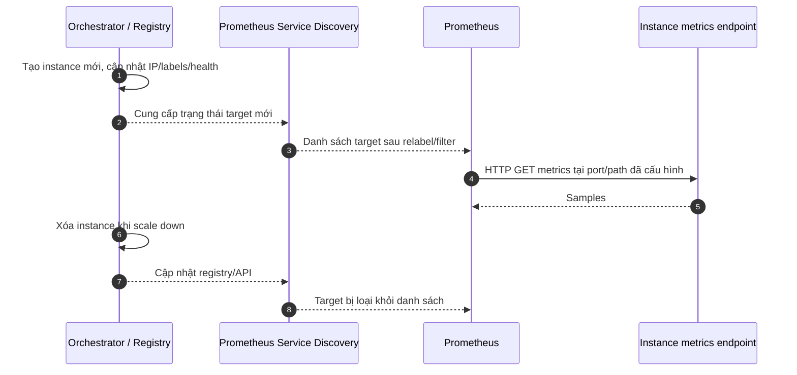
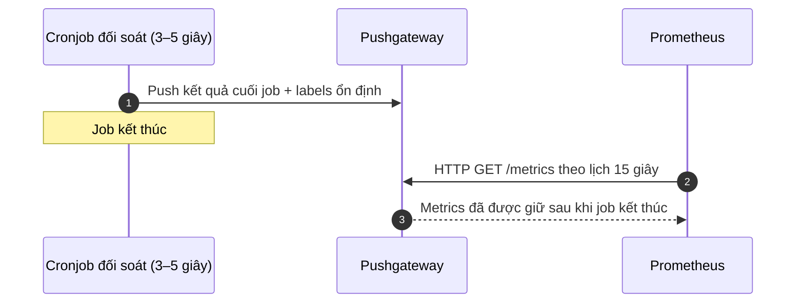

# BÁO CÁO BÀI 5: PHÂN TÍCH CƠ CHẾ PULL CỦA PROMETHEUS VS PUSH CỦA CÁC HỆ THỐNG GIÁM SÁT

## Tóm tắt điều hành

Pull và Push mô tả hướng khởi tạo luồng chuyển metrics, không phải thước đo tuyệt đối về chất lượng. Prometheus chủ động scrape endpoint của từng target; các hệ thống như Datadog Agent, Telegraf hoặc AWS CloudWatch Agent thường thu thập tại host/service rồi gửi dữ liệu về backend. Agent có thể tự thu thập theo kiểu pull tại máy cục bộ nhưng push batch lên nền tảng trung tâm. Vì vậy cần phân biệt **cách lấy dữ liệu từ ứng dụng** với **cách chuyển dữ liệu qua mạng**.

Với microservices chạy trong Kubernetes hoặc mạng nội bộ, Prometheus kết hợp Service Discovery phù hợp khi muốn kiểm soát scrape, kiểm tra tình trạng từng target và dùng hệ sinh thái PromQL/rules. Với mạng bị NAT/firewall, batch job ngắn hạn hoặc yêu cầu SaaS quản lý agent, mô hình agent/push có thể phù hợp hơn. Một kiến trúc thực tế có thể kết hợp cả hai, nhưng phải quy định rõ nguồn dữ liệu, nhãn, quyền sở hữu và tránh thu thập trùng.

## Phần 1. Giới thiệu

### 1.1 Bối cảnh và mục tiêu

Hệ thống E-commerce giả định có API gateway, catalog, order, payment, inventory và các worker bất đồng bộ. Số replica thay đổi theo tải và có thể được tạo/xóa tự động. Monitoring (giám sát) giúp đội vận hành quan sát sức khỏe, hiệu năng và xu hướng sử dụng; metrics (chỉ số dạng số theo thời gian) là một nguồn dữ liệu quan trọng cho cảnh báo, capacity planning và điều tra sự cố.

Bài phân tích trả lời câu hỏi: nếu Prometheus phải “đi gõ cửa” nhiều service, làm sao theo dõi các instance biến động? Khi nào để agent gửi dữ liệu lên backend trung tâm có lợi hơn? Mục tiêu là so sánh trade-off có điều kiện, không kết luận Pull hoặc Push luôn tốt hơn.

### 1.2 Thuật ngữ

| Thuật ngữ | Ý nghĩa |
|---|---|
| Metric | Đại lượng có tên, giá trị, timestamp và có thể kèm labels; ví dụ số request hoặc thời gian CPU. |
| Target | Endpoint mà Prometheus dự kiến scrape. |
| Instance | Một tiến trình/endpoint cụ thể có thể scrape; thường được định danh bằng `host:port`. |
| Job | Nhóm các instance có cùng vai trò, ví dụ `payment-api`. |
| Scrape | Prometheus gửi HTTP request định kỳ tới endpoint metrics và thu thập các sample. |
| Agent | Tiến trình triển khai gần host/service, thu thập hoặc xử lý dữ liệu rồi có thể gửi lên hệ thống trung tâm. |
| Service Discovery (SD) | Cơ chế phát hiện danh sách target từ nền tảng như Kubernetes hoặc Consul, thay vì nhập từng IP tĩnh. |
| Auto-scaling | Tự động tăng/giảm replica theo tải hoặc chính sách vận hành. |
| Time series | Chuỗi sample có cùng tên metric và cùng bộ labels theo thời gian. |
| Cardinality | Số lượng tổ hợp series khác nhau; nhãn có giá trị biến thiên lớn có thể làm cardinality và chi phí lưu trữ tăng mạnh. |
| Remote Write | Giao thức Prometheus gửi các sample đã scrape từ Prometheus tới hệ thống lưu trữ/nhận tương thích; không đồng nghĩa ứng dụng tự push metrics. |

## Phần 2. Cơ chế Pull của Prometheus

### 2.1 Luồng hoạt động

Exporter hoặc ứng dụng instrument bằng Micrometer/client library cung cấp endpoint HTTP, thường là `/metrics` hoặc `/actuator/prometheus`. Prometheus dùng cấu hình scrape và danh sách target để gửi HTTP GET theo chu kỳ, chẳng hạn `scrape_interval: 15s`. Nó parse response, gắn nhãn `job` và `instance`, ghi sample vào TSDB (time-series database) cục bộ, sau đó cho phép truy vấn bằng PromQL và đánh giá recording/alerting rules.

`up{job="...",instance="..."}` được Prometheus tạo cho mỗi target: giá trị `1` khi lần scrape gần nhất thành công, `0` khi scrape thất bại. Đây là trạng thái scrape, không phải kết luận toàn diện rằng mọi chức năng nghiệp vụ của service khỏe mạnh. Service có thể trả metrics thành công nhưng endpoint nghiệp vụ hoặc database đã lỗi.

### 2.2 Ưu điểm của Pull

- **Quan sát trạng thái thu thập:** Prometheus chủ động biết endpoint nào phản hồi, thời gian scrape và số sample được lấy; lỗi có thể hiện ở target/`up`.
- **Không cần mỗi backend biết địa chỉ hệ thống monitoring:** ứng dụng chỉ expose endpoint theo hợp đồng; không cần mã gửi metrics, credential backend monitoring hoặc logic retry đến server trung tâm.
- **Kiểm soát tập trung:** scrape interval, timeout, relabeling, allowlist target và TLS/auth được cấu hình tại collector.
- **Phát hiện target qua SD:** target động có thể được lấy từ API nền tảng, thay vì cập nhật IP thủ công.
- **Phù hợp pull trong mạng kiểm soát:** Prometheus đặt trong cùng cluster/VPC có thể truy cập target qua mạng riêng mà không cần mở cổng inbound từ Internet.

### 2.3 Hạn chế và dữ liệu có thể mất

- Prometheus phải có đường mạng tới endpoint và endpoint phải cho phép scrape; firewall/NAT có thể cản kết nối.
- Target cần expose endpoint metrics và đủ tài nguyên để trả response. Scrape quá dày hoặc lượng series lớn vẫn tạo tải mạng/CPU.
- Pull không lưu lại những snapshot chưa scrape. Nếu Prometheus ngừng hoạt động, ứng dụng thường vẫn chạy, nhưng lần scrape trong thời gian ngừng sẽ không được lấy. Exporter thông thường không giữ lịch sử để gửi bù.
- Nếu target biến mất trước lần scrape tiếp theo, sample cuối có thể cũ và dữ liệu trong khoảng đó không được quan sát. Nếu target bật/tắt nhanh hơn chu kỳ, SD hoặc scrape interval, có thể bỏ lỡ instance.
- Prometheus local TSDB là thành phần lưu trữ cục bộ, không tự động trở thành hệ thống clustered/replicated. Cần backup, remote storage hoặc kiến trúc HA phù hợp theo yêu cầu RPO/RTO.
- Service Discovery chỉ cung cấp danh sách địa chỉ/metadata; không tự làm endpoint sẵn sàng, không tự bảo đảm quyền truy cập, cổng/path đúng hay dung lượng Prometheus đủ.

### 2.4 Vì sao Pull tách rời nghiệp vụ

Backend chỉ cần instrument code và expose endpoint. Nếu Prometheus tạm dừng, backend không cần chờ HTTP push, xử lý queue, quản lý credential monitoring hay retry gửi dữ liệu; request nghiệp vụ không bị phụ thuộc vào availability của nền tảng metrics theo thiết kế này. Tuy vậy, instrumentation vẫn tiêu tốn CPU/memory, endpoint metrics có thể bị scrape gây tải, và ứng dụng vẫn phải bảo vệ endpoint phù hợp.

## Phần 3. Cơ chế Push và các hệ thống Agent

### 3.1 Mô hình chung

Trong mô hình Push, ứng dụng hoặc agent thu thập/nhận dữ liệu rồi chủ động gửi batch tới backend. SDK có thể ghi metric trong process; agent có thể đọc OS, log, endpoint hoặc protocol cục bộ. Agent thường hỗ trợ buffer, batch, retry và xác thực, nhưng cách thực hiện và giới hạn phụ thuộc sản phẩm/cấu hình. Không nên giả định mọi agent có buffer bền vững hoặc retry vô hạn.

### 3.2 Datadog Agent

Datadog Agent là phần mềm chạy trên host/container, thu thập system metrics, events và dữ liệu từ checks/integrations rồi gửi lên nền tảng Datadog. Agent có cấu hình site và API key; integrations bổ sung dữ liệu dịch vụ. Đây là ví dụ agent-to-platform: service không nhất thiết phải tự viết client gửi từng sample. Agent có thể scrape endpoint Prometheus/OpenMetrics như một integration, vì vậy **cách Agent lấy metrics từ service có thể là Pull**, trong khi **Agent gửi dữ liệu ra Datadog là outbound Push**.

Lợi ích: có collector dùng lại được, quản lý tập trung, outbound kết nối thường dễ đi qua firewall hơn inbound scrape. Hạn chế: cần cài và quản lý agent, quyền truy cập credential, kiểm soát cấu hình/phiên bản, network outbound, và chi phí nền tảng thường phụ thuộc lượng/loại metrics, host hoặc custom metrics theo hợp đồng. Cần xem pricing hiện hành trước khi ước lượng.

### 3.3 Telegraf

Telegraf là agent/plugin-based data collector của InfluxData. Plugin **inputs** thu thập, **processors/aggregators** biến đổi/tổng hợp, **outputs** gửi tới hệ thống đích. Telegraf không phải một giao thức Push duy nhất: input có thể chủ động poll (ví dụ đọc endpoint), output có thể ghi/push tới backend; cấu hình quyết định hướng và semantics. Một số plugin cho phép expose metrics theo định dạng Prometheus để Prometheus scrape, nên Telegraf cũng có thể đứng ở phía target Pull.

Ưu điểm là một agent gom nhiều nguồn, xử lý trước và xuất tới nhiều loại output; hạn chế là phải vận hành plugin/config, quản lý buffering/retry theo từng output, schema/labels và tương thích đích nhận. Không nên gọi mọi triển khai Telegraf là push end-to-end.

### 3.4 AWS CloudWatch Agent

CloudWatch Agent thu thập metrics hệ thống, logs và một số dữ liệu ứng dụng trên EC2/on-premises/container; có thể gửi metrics tới CloudWatch hoặc Amazon Managed Service for Prometheus trong các cấu hình hỗ trợ. Việc gửi tới AWS yêu cầu network, cấu hình agent và IAM credentials/role có quyền phù hợp. Hướng này hữu ích khi tổ chức dùng dịch vụ AWS quản lý, nhưng tạo phụ thuộc IAM/region/network và có thể phát sinh chi phí custom metrics/log ingestion; kiểm tra chính sách giá hiện hành.

### 3.5 Agent Push không đồng nghĩa ứng dụng tự gửi

Hai mẫu khác nhau:

1. **Ứng dụng tự Push:** code ứng dụng biết endpoint nhận, credential, batching, retries và xử lý lỗi. Tạo coupling vận hành giữa business service và monitoring; retry đồng bộ sai có thể ảnh hưởng request.
2. **Agent Push:** ứng dụng expose local interface/log/protocol hoặc ghi qua SDK; agent thu thập, buffer/batch và gửi đi. Tách bớt logic vận chuyển khỏi business code, nhưng cần vận hành agent và hiểu rõ buffer persistence, retry, back-pressure, disk quota, credential.

Push giúp vượt một số ranh giới mạng, không xóa bỏ lỗi mạng: nếu backend nhận unavailable lâu hơn buffer retention/disk quota, dữ liệu có thể drop; retry có thể trễ hoặc gửi lại; tốc độ đẩy vượt ingest capacity cần queue/rate limiting.

## Phần 4. Bảng so sánh Pull và Push

| Tiêu chí | Pull (Prometheus scrape) | Push (agent/SDK gửi) |
|---|---|---|
| 1. Ai khởi tạo truyền dữ liệu | Prometheus mở kết nối đến target theo lịch. | Agent/SDK chủ động gửi tới backend hoặc gateway. |
| 2. Cấu hình ban đầu | Cần scrape job, target/discovery, path, port, auth/TLS. | Cần agent/SDK, endpoint, credential, output, batch/retry và policy. |
| 3. Phát hiện target mới | SD có thể tự cập nhật target từ Kubernetes/Consul; không tự động nếu chưa cấu hình. | Agent thường được cài theo host/cluster hoặc workload; backend nhận dữ liệu khi agent đăng ký/gửi, nhưng inventory/identity vẫn phải quản lý. |
| 4. Target không phản hồi | `up=0` cho scrape thất bại; hỗ trợ cảnh báo liveness scrape. | Có thể thấy agent heartbeat/last-seen nếu nền tảng cung cấp; lỗi giữa hai lần heartbeat có độ trễ. |
| 5. Ảnh hưởng Backend | Backend expose endpoint; scrape tốn tài nguyên nhưng không phải gửi ra xa. | SDK có thể thêm code và network call; agent thường tách việc gửi nhưng vẫn tiêu thụ tài nguyên host. |
| 6. Buffer dữ liệu | Prometheus không yêu cầu exporter buffer snapshot; mất lần scrape khi collector/target unavailable. TSDB/WAL bảo vệ dữ liệu đã nhận ở mức local, không thay thế buffer tại target. | Có thể buffer tại agent/gateway, nhưng persistence, dung lượng, retention và drop policy tùy sản phẩm/cấu hình. |
| 7. Retry | Scrape thất bại sẽ thử lại ở chu kỳ kế tiếp; không tự lấy bù mọi snapshot đã bỏ lỡ. | Agent thường có retry/backoff tùy cấu hình; retries không bảo đảm vô hạn hoặc exactly-once. |
| 8. NAT/firewall/mạng riêng | Prometheus cần route tới target; đặt Prometheus gần targets, private networking, VPN hoặc proxy giải quyết. | Outbound agent connection thường dễ đi qua firewall hơn; cần egress DNS/TLS/port tới backend và credential. |
| 9. Mở rộng | SD loại bỏ danh sách tĩnh; phải tính scrape concurrency, series, scrape interval, storage và shard/partition. | Có thể phân tán agent nhưng backend ingest, queue, cardinality và chi phí vẫn có giới hạn. |
| 10. Job ngắn hạn | Có thể bỏ lỡ nếu job kết thúc trước scrape. Pushgateway/textfile collector có điều kiện dùng riêng. | Agent có thể gửi kết quả cuối job nếu code/agent giữ và chuyển được; durability phụ thuộc buffer. |
| 11. Bảo mật | Cần bảo vệ endpoint khỏi truy cập trái phép, dùng TLS/auth/network policy và hạn chế target; inbound được giới hạn trong mạng monitoring. | Credential/API key trên agent cần bảo vệ; outbound TLS/IAM và quyền tối thiểu; rò key có thể ảnh hưởng nhiều dữ liệu. |
| 12. Chi phí/độ phức tạp | Prometheus tự vận hành: capacity, HA, retention, upgrades, SD/RBAC. Không có phí SaaS mặc định nhưng vẫn có chi phí hạ tầng/vận hành. | Agent fleet, backend SaaS, ingest/retention/cardinality và chi phí license; giảm phần tự vận hành storage nhưng thêm vendor/config management. |
| 13. Đồng nhất nhãn/danh tính | Labels do scrape config/relabeling và instrumentation; cần tránh nhãn động cardinality cao. | Agent mapping/tagging có thể chuẩn hóa tập trung, nhưng dễ phát sinh tag không đồng nhất giữa cấu hình. |
| 14. Điều tra lỗi | Target, `up`, scrape duration/error cho biết việc kéo dữ liệu; không tự chứng minh nghiệp vụ khỏe. | Agent/backend health và last-seen hữu ích; cần phân biệt lỗi app→agent với agent→backend. |

## Phần 5. Bài toán 1.000 microservices Auto-scaling

### 5.1 Luồng Service Discovery

Điểm quan trọng: Prometheus **không mặc định tự biết** mọi service chỉ vì được cài đặt. Cần một nguồn discovery đáng tin cậy, quyền truy cập, tiêu chí lọc target, cổng/path metrics và relabeling phù hợp.

Các bước: instance được tạo → orchestrator/registry đăng ký metadata → Prometheus discovery đồng bộ → relabeling chọn endpoint metrics → scrape → khi instance bị xóa, discovery loại target. Có độ trễ đồng bộ và chu kỳ scrape; instance tồn tại rất ngắn có thể bị bỏ lỡ. Cần readiness, metrics endpoint sẵn sàng trước khi được scrape.

### 5.2 Kubernetes Service Discovery

Prometheus có cấu hình `kubernetes_sd_config` dùng Kubernetes API để discover pods, services, endpoints/endpointslices hoặc nodes tùy role và phiên bản. Cần:

- Prometheus chạy trong cluster hoặc có API server/network/TLS credentials tới cluster.
- ServiceAccount/RBAC chỉ cấp quyền `list`/`watch` tài nguyên cần thiết (ví dụ pods, services, endpoints/endpointslices, namespaces).
- `relabel_configs` lọc namespace, label, annotation và đặt target port/path/scheme phù hợp.
- App có endpoint metrics và network policy cho phép Prometheus truy cập.
- Nếu dùng Prometheus Operator, `ServiceMonitor`/`PodMonitor` và label selection phải khớp; Operator không có nghĩa discovery tự hoạt động nếu selector/RBAC/scrape endpoint sai.

Kubernetes Service/Service DNS hữu ích cho traffic ứng dụng, nhưng scrape từng replica thường cần discovery endpoint/pod phù hợp; scrape một ClusterIP service có thể chỉ quan sát một backend được load-balance mỗi lần chứ không đảm bảo thu thập từng replica.

### 5.3 Consul Service Discovery

Prometheus hỗ trợ `consul_sd_config` để truy vấn Consul Catalog. Cần Consul agent/server và registration của service có địa chỉ, port, tags/metadata/health check; Prometheus cần network/DNS, ACL token nếu ACL bật, và relabeling chọn đúng service/tag/metrics port. Health check Consul và scrape health có ý nghĩa khác nhau: service có thể registered/healthy theo Consul nhưng metrics endpoint vẫn lỗi.

### 5.4 Eureka Service Discovery

Eureka là registry/client ecosystem của Netflix/Spring Cloud; ứng dụng đăng ký metadata của instance và gửi heartbeat. **Prometheus có `eureka_sd_configs` native trong cấu hình Service Discovery chính thức**. Vì vậy adapter không phải điều kiện bắt buộc. Cần cấu hình Eureka server URL có thể truy cập từ Prometheus, refresh interval phù hợp, TLS/auth/credentials nếu registry yêu cầu, và relabeling để lọc ứng dụng hoặc biến metadata thành target address/labels.

Eureka registration mặc định mô tả host/port ứng dụng; điều đó không đảm bảo metrics endpoint chạy cùng port hoặc có đường dẫn `/actuator/prometheus`. Hãy xác định metrics port/path/scheme bằng quy ước ổn định hoặc metadata, và cấu hình relabeling/metrics path tương ứng. Prometheus phải route tới địa chỉ instance được Eureka quảng bá; hostname/IP trong registry không phải lúc nào cũng reachable từ container/cluster khác.

Nếu Prometheus/version/deployment đang dùng không hỗ trợ hoặc không thể truy cập trực tiếp Eureka, khi đó mới cân nhắc adapter/bridge thành `file_sd_configs` hay giải pháp discovery khác. Kiểm tra schema bằng `promtool` đúng phiên bản đang chạy, đồng thời bảo vệ Eureka API và thông tin xác thực.

### 5.5 Quy mô và giới hạn

“1.000 microservices” cần phân biệt 1.000 service logic với số **instance/replica** đang chạy. Nếu 1.000 targets mỗi target có 1.000 series và scrape mỗi 15 giây, phép tính minh họa là khoảng `1,000 × 1,000 ÷ 15 ≈ 66,667 samples/giây` trước khi tính labels, scrape overhead, histogram buckets, churn và storage. Đây chỉ là phép tính theo giả định, không phải benchmark hay cam kết năng lực.

Scale cần đánh giá CPU/RAM Prometheus, số targets, scrape duration/concurrency, bytes/sample, cardinality, churn, retention, WAL/disk I/O và query/rule load. Có thể phân vùng/shard theo cluster/region/team/service, dùng Prometheus per-cluster và federation hoặc remote_write tới hệ lưu trữ dài hạn. SD giúp target discovery, không loại bỏ capacity planning.

## Phần 6. Pushgateway và Cronjob

### 6.1 Ví dụ job chạy ngắn

Cronjob đối soát đơn hàng chạy 3–5 giây; Prometheus scrape mỗi 15 giây. Nếu job expose metrics chỉ khi tiến trình đang chạy và kết thúc trước lần scrape tiếp theo, Prometheus không nhìn thấy endpoint; metrics kết quả của lần chạy có thể mất.

### 6.2 Khi nào dùng Pushgateway

Pushgateway là intermediary giữ metrics từ job không thể được scrape trực tiếp, để Prometheus scrape Pushgateway. Tài liệu Prometheus khuyến nghị use case giới hạn, chủ yếu là **service-level batch jobs**: kết quả tổng thể của job thuộc service, không gắn vòng đời với một host/instance cụ thể.

Luồng ví dụ: job chạy → cập nhật metric kết quả (thành công/thất bại, timestamp, số bản ghi) lên Pushgateway → Prometheus scrape gateway → alert/query. Pushgateway không phải TSDB dài hạn, không tự tạo lịch sử đầy đủ, không chứng minh job còn chạy và cũng không tự xác nhận lần chạy gần nhất thành công trừ khi job push metrics biểu đạt kết quả/thời gian.

### 6.3 Hạn chế và quản lý vòng đời

- Pushgateway là điểm trung gian; nếu gateway hỏng, push/scrape qua gateway bị ảnh hưởng. Một gateway chia sẻ cho nhiều jobs có thể thành bottleneck/SPOF nếu không thiết kế HA phù hợp.
- Gateway giữ các series đã push cho tới khi bị xóa; dữ liệu cũ có thể tồn tại sau khi job/instance kết thúc. Thiết kế grouping key ổn định, tránh nhãn `instance` không cần thiết, và xóa đúng nhóm qua API hoặc automation có kiểm soát.
- Do Prometheus scrape gateway chứ không scrape từng job, metric `up` nói gateway scrape được hay không, không cho biết job gốc vừa chạy thành công. Job cần push `last_success_timestamp`, trạng thái kết quả hoặc counter phù hợp.
- Không dùng Pushgateway để thay scrape liên tục mọi microservice; mất target-level health và vòng đời target tự nhiên.

### 6.4 Textfile collector của Node Exporter

Với cronjob gắn với một máy cụ thể (ví dụ chạy cập nhật bảo mật trên host), Prometheus hướng dẫn cân nhắc Node Exporter textfile collector: job ghi file exposition text vào thư mục collector, exporter được scrape như thường. Ghi file an toàn (temporary file rồi atomic rename), quản lý file cũ và nhãn theo host; không ghi metric có timestamp sample tùy ý vì textfile collector có quy tắc exposition riêng. Phương án này giữ quan hệ dữ liệu với node nhưng yêu cầu job có quyền ghi file và Node Exporter đọc được thư mục.

### 6.5 Khi nào chọn giải pháp khác

- Job chạy dài: expose endpoint và scrape trực tiếp.
- Batch theo host: Node Exporter textfile collector có thể hợp lý.
- Batch service-level không thể scrape: Pushgateway.
- Mạng outbound-only/agent fleet hoặc SaaS: agent/managed push phù hợp, cân nhắc buffer, IAM/API key, retention và cost.

## Phần 7. Phân tích tình huống sự cố

| Sự cố | Nguyên nhân | Hệ quả | Metrics/log cần kiểm tra | Xử lý | Giới hạn còn lại |
|---|---|---|---|---|---|
| 1. Prometheus tạm ngừng | Process/host/disk/upgrade lỗi. | Không có scrape trong thời gian dừng; app thường tiếp tục chạy. | Prometheus process/log, restart count, disk/WAL, `up`, Alertmanager, remote storage health. | HA/replica phù hợp; giữ Prometheus gần targets; backup/retention; external storage nếu cần; giám sát chính Prometheus. | Scrape sample chưa thu trong thời gian down không tự được exporter gửi bù; HA không tự tạo exactly-once. |
| 2. Backend chạy nhưng metrics endpoint lỗi | Mapping path sai, actuator không expose, auth, exception hoặc saturation. | Business API có thể vẫn chạy nhưng metrics scrape thất bại; `up=0` cho scrape đó. | `/targets` last error, HTTP status, app logs, Actuator exposure, request/CPU, `scrape_duration_seconds`. | Kiểm tra path/port/network/auth, readiness, instrument endpoint; alert tách health nghiệp vụ với scrape. | Endpoint metrics thành công cũng không bảo đảm tất cả nghiệp vụ tốt. |
| 3. Service mới chưa được discovery | RBAC/ACL, selector/relabel sai, metadata/port thiếu, đồng bộ trễ. | Target không xuất hiện nên không có `up` series cho instance đó. | Prometheus `/service-discovery`, target page, Kubernetes events/API, Consul catalog/Eureka registration và Prometheus discovery logs. | Sửa quyền/selector/labels, cổng/path, network; kiểm tra discovery refresh. | SD không phát hiện target trước khi nguồn registry cập nhật; instance rất ngắn có thể biến mất trước scrape. |
| 4. Cronjob kết thúc trước scrape | Thời gian job < scrape interval; endpoint biến mất sau exit. | Metrics của lượt chạy không được Prometheus lấy. | Job start/end logs, exit status, target history, timestamps của job metrics. | Pushgateway cho service-level job hoặc textfile collector cho job gắn với host; publish last success/failure timestamp. | Pushgateway giữ stale data; gateway scrape `up` không chứng minh job vừa chạy tốt. |
| 5. Agent Push mất kết nối | DNS/TLS/firewall/credential/backend outage, quota hoặc throttling. | Agent có thể buffer/retry hoặc drop tùy implementation/cấu hình; dữ liệu trễ, trùng hoặc mất. | Agent logs/status, queue/buffer size, dropped/retry counters, backend ingest errors, IAM/API key expiry, egress telemetry. | Kiểm tra network/TLS/auth/quota; cấu hình backoff, buffer persistence/limits, alert queue saturation; rotate credentials an toàn. | Buffer hữu hạn; retry không đảm bảo giao nhận vô hạn/đúng một lần; tăng buffer có thể tốn disk và tăng độ trễ. |
| 6. Prometheus scrape target chậm | Endpoint nhiều series, CPU/GC, network congestion, timeout thấp. | Scrape duration cao hoặc scrape thất bại, tạo khoảng trống dữ liệu. | `scrape_duration_seconds`, `scrape_samples_scraped`, target error, app latency/GC, Prometheus CPU. | Giảm cardinality, tăng timeout/interval hợp lý, phân shard, tối ưu endpoint. | Interval cao hơn giảm độ phân giải và phát hiện chậm; scale ngang tăng chi phí vận hành. |

`up=0` thường biểu thị lần scrape thất bại; target không được discovery có thể không có series `up` để báo 0. Alert cần phân biệt “target down” với “target không tồn tại/không được phát hiện”.

## Phần 8. Kiến trúc đề xuất cho E-commerce

### 8.1 Kiến trúc nền

- Mỗi Spring Boot service instrument bằng Micrometer và expose Actuator Prometheus endpoint trong mạng nội bộ; không public endpoint metrics ra Internet.
- Prometheus đặt gần workloads, dùng Kubernetes SD nếu chạy trên Kubernetes hoặc Consul SD nếu Consul là registry; discovery đi kèm RBAC/ACL tối thiểu, relabeling, metrics port/path và network policy.
- Prometheus scrape liên tục metrics service/node; dùng `up`, scrape duration/sample metrics và application SLI/SLO metrics cho cảnh báo.
- Grafana là lớp dashboard tùy chọn; Alertmanager hoặc nền tảng cảnh báo nhận alert rules.
- Pushgateway chỉ cho service-level batch job ngắn không thể scrape; job phải xuất outcome/last-success metric và có quy trình dọn stale groups.
- Với host-bound scripts, cân nhắc Node Exporter textfile collector.
- Nếu cần SaaS/egress-only hoặc thu thập log/metrics/traces theo agent, cân nhắc Datadog Agent, Telegraf hoặc CloudWatch Agent theo IAM/network/data-retention/cost policy.
- Nếu cần lưu dài hạn hoặc nhiều Prometheus, remote_write tới backend tương thích là hướng gửi **từ Prometheus** sau scrape; nó không thay thế target discovery và không phải ứng dụng tự gửi metrics.

### 8.2 Điều kiện để vận hành hiệu quả

1. Thống nhất naming/labels; không dùng user ID/order ID hoặc giá trị vô hạn làm labels.
2. Chỉ expose metrics cần thiết; bảo vệ bằng private network, TLS/auth khi phù hợp, RBAC/network policy và secrets manager.
3. Đặt Prometheus gần workloads; kiểm tra SD latency, scrape interval/timeout và readiness.
4. Capacity plan theo replicas × series/target × tần suất, scrape payload, churn, retention, queries/rules và WAL/disk.
5. Đánh giá HA, backup, remote storage, retention và quy trình nâng cấp/khôi phục.
6. Giám sát chính pipeline: Prometheus health, target discovery, scrape errors, agent queue, gateway stale metrics và backend ingest.
7. Không gửi cùng một metric qua nhiều đường nếu chưa định nghĩa deduplication/ownership và nguồn chuẩn.

## Phần 9. Kết luận bảo vệ kiến trúc

**1. Tại sao vẫn chọn Prometheus?**  
Với services có thể reach trong cluster/mạng riêng và có endpoint metrics chuẩn, Pull tạo mô hình đơn giản, có `up` theo target, kiểm soát scrape tập trung và tích hợp tự nhiên với Kubernetes, PromQL và alert rules. Lựa chọn này hợp lý nếu tổ chức chấp nhận tự vận hành Prometheus và thiết kế storage/HA/capacity. Không phải lựa chọn mặc định cho mọi môi trường.

**2. Làm sao giám sát 1.000 service thay đổi liên tục?**  
Không quản lý IP thủ công: tích hợp Service Discovery phù hợp (Kubernetes, Consul hoặc Eureka native `eureka_sd_configs`), lọc/relabel target, cho phép metrics port/path và quyền mạng. Phân shard/Prometheus theo cluster hoặc miền trách nhiệm khi cần. Service Discovery giải quyết “target ở đâu”, còn capacity planning giải quyết “Prometheus có đủ khả năng scrape/lưu/truy vấn không”.

**3. Khi nào dùng Pushgateway hoặc nền tảng Push?**  
Dùng Pushgateway chủ yếu cho kết quả tổng thể của batch job ngắn không thể scrape; không dùng làm nơi lưu trữ dài hạn hay thay scrape mọi service. Dùng agent/managed push khi network chỉ cho outbound, cần agent gom nhiều nguồn hoặc muốn giảm tự vận hành backend, với điều kiện kiểm soát credential, buffer, retry, quota, cost và mất dữ liệu.

Quan điểm kiến trúc: chọn theo topology, thời lượng workload, yêu cầu độ bền dữ liệu, ranh giới mạng, năng lực đội vận hành và chi phí. Pull và Push có thể cùng tồn tại với ranh giới rõ ràng.

## Phần 10. Câu hỏi bảo vệ và đáp án

1. **Pull có làm Backend nhẹ hơn trong mọi trường hợp không?**  
   Không. Nó tránh code/network push và credential tới monitoring, nhưng endpoint scrape vẫn tiêu thụ CPU, memory, network; scrape dày hoặc cardinality lớn có thể nặng.
2. **Nếu Prometheus chết thì điều gì xảy ra?**  
   Backend thường tiếp tục chạy; Prometheus không scrape được trong thời gian dừng và thông thường không lấy bù snapshot đã bỏ lỡ. HA/remote storage giảm một số rủi ro nhưng không tự giải quyết mọi mất dữ liệu.
3. **`up = 0` có nghĩa gì?**  
   Target đã được scrape nhưng scrape gần nhất thất bại. Target không được discovery có thể không có series `up`, vì chưa tồn tại target để scrape.
4. **Prometheus phát hiện Pod mới bằng cách nào?**  
   `kubernetes_sd_config` truy vấn Kubernetes API; RBAC, role, relabeling, namespace/label selector, port/path và network phải được cấu hình.
5. **Service Discovery có tự động hoạt động không?**  
   Không chỉ cài Prometheus là đủ. Cần cấu hình nguồn discovery và quyền truy cập, tiêu chí lọc/relabel cùng endpoint có thể scrape.
6. **1.000 service có khiến Prometheus quá tải không?**  
   Không thể kết luận chỉ từ số service. Tải phụ thuộc số instance, số series, scrape interval, payload, cardinality, churn, retention và query/rules. Cần đo/capacity plan, shard khi cần.
7. **Pushgateway khác Prometheus như thế nào?**  
   Prometheus là collector và TSDB; Pushgateway là intermediary giữ metrics được job push để Prometheus scrape. Gateway không thay TSDB hay cung cấp target health của job gốc.
8. **Khi nào Cronjob cần Pushgateway?**  
   Khi job service-level chạy ngắn, không thể scrape và cần công bố kết quả cuối. Nếu job gắn với host, Node Exporter textfile collector có thể hợp lý hơn.
9. **Agent Push có giải quyết hoàn toàn lỗi mạng không?**  
   Không. Buffer/retry giúp chịu lỗi tạm thời nhưng hữu hạn; có thể đầy, hết hạn, drop, retry trễ hoặc gửi lặp tùy implementation.
10. **Có thể kết hợp Pull và Push trong cùng hệ thống không?**  
    Có. Ví dụ Prometheus scrape services và exporters, còn batch job push kết quả vào Pushgateway; cần phân định labels, ownership và tránh duplicate ingestion.
11. **Tại sao không push trực tiếp từ từng request của ứng dụng?**  
    Điều đó gắn latency/availability/credential monitoring vào business path và tạo lượng request lớn. Thường dùng instrumentation cục bộ hoặc agent, không gửi từng event đồng bộ nếu không có lý do.
12. **Eureka có thể cấu hình Prometheus giống Kubernetes không?**  
    Prometheus hỗ trợ `eureka_sd_configs` native. Cần khai báo Eureka server URL, đảm bảo network/TLS/auth, rồi relabel và xác định đúng metrics port/path; adapter chỉ cần nếu phiên bản/topology không dùng được trực tiếp.
13. **Remote Write là Push của ứng dụng phải không?**  
    Không. Prometheus scrape targets trước, rồi Prometheus gửi các sample tới remote storage qua Remote Write.
14. **Pushgateway có xóa metrics tự động khi cronjob dừng không?**  
    Không. Series tồn tại cho tới khi được xóa; cần grouping key và lifecycle cleanup.
15. **Agent buffer bảo đảm không mất dữ liệu chứ?**  
    Không. Buffer giới hạn bởi dung lượng/retention/chính sách drop và có thể mất cùng host nếu không persistent.

## Phần 11. Tài liệu tham khảo

Các tài liệu dưới đây được truy cập/kiểm tra tính liên quan vào ngày 27-10-2026. Trang cấu hình Prometheus là tài liệu rolling/latest; cần đối chiếu phiên bản triển khai thực tế trước khi dùng tính năng cụ thể.

1. Prometheus, **Jobs and Instances** — khái niệm job, instance, labels và `up`:  
   https://prometheus.io/docs/concepts/jobs_instances/
2. Prometheus, **When to use the Pushgateway** — giới hạn, stale metrics và batch job service-level:  
   https://prometheus.io/docs/practices/pushing/
3. Prometheus, **Configuration** — scrape config, `kubernetes_sd_config`, `consul_sd_config`, reload và các discovery mechanism được hỗ trợ:  
   https://prometheus.io/docs/prometheus/latest/configuration/configuration/
4. Prometheus, **Pushing metrics** — vai trò Pushgateway và client libraries:  
   https://prometheus.io/docs/instrumenting/pushing/
5. Prometheus, **Storage** — local TSDB, WAL và giới hạn local storage:  
   https://prometheus.io/docs/prometheus/latest/storage/
6. Prometheus Node Exporter, **Textfile collector**:  
   https://github.com/prometheus/node_exporter#textfile-collector
7. Datadog, **Getting Started with the Agent** — agent chạy trên host, thu thập và gửi dữ liệu:  
   https://docs.datadoghq.com/getting_started/agent/
8. InfluxData, **Telegraf documentation** — agent và input/processor/aggregator/output plugin model:  
   https://docs.influxdata.com/telegraf/
9. AWS, **Collect metrics, logs, and traces using the CloudWatch agent** — nguồn thu thập và destinations gồm CloudWatch/AMP theo cấu hình:  
   https://docs.aws.amazon.com/AmazonCloudWatch/latest/monitoring/Install-CloudWatch-Agent.html
10. Spring Cloud Netflix, **Eureka Discovery Client** — đăng ký instance, metadata, heartbeat và cấu hình client:  
    https://docs.spring.io/spring-cloud-netflix/reference/spring-cloud-netflix.html

Lưu ý về Eureka: trang cấu hình Prometheus chính thức liệt kê `eureka_sd_configs` là một discovery mechanism được hỗ trợ. Hãy xem schema/version của Prometheus đang triển khai và kiểm tra bằng `promtool`; Eureka registry metadata vẫn cần được chuyển thành đúng scrape address, port/path qua relabeling/quy ước ứng dụng.
