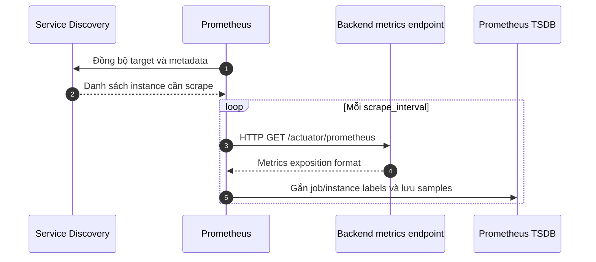
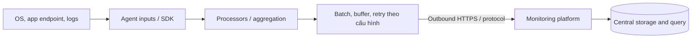
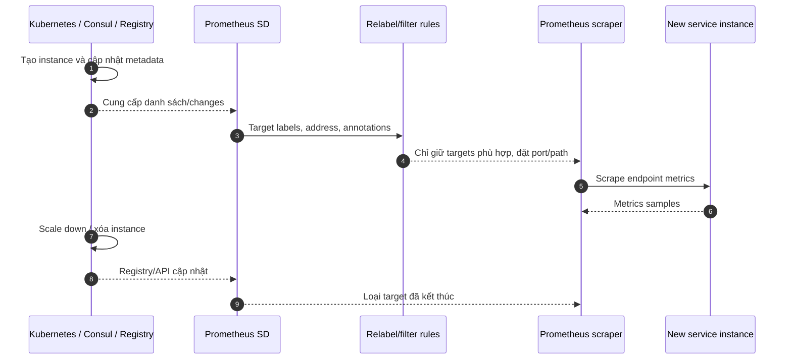
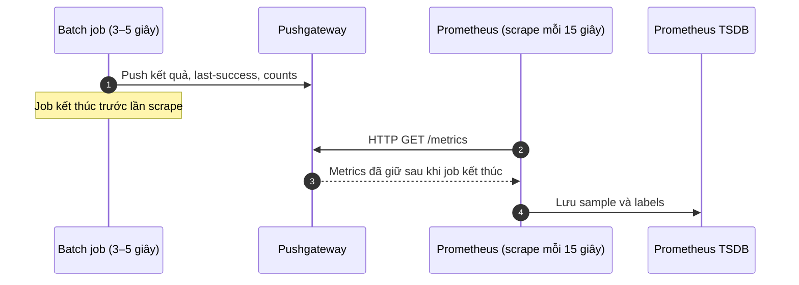

# Sơ đồ kiến trúc — Bài 5 Pull vs Push

## 1. Prometheus Pull

## 2. Agent thu thập rồi Push

Agent có thể poll endpoint tại chỗ (Pull local) nhưng gửi batch ra nền tảng (Push outbound). Chiều thu thập ở nguồn và chiều vận chuyển tới backend là hai khái niệm khác nhau.

## 3. Service Discovery và Auto-scaling

Discovery cần cấu hình và quyền truy cập. Prometheus có discovery config cho Kubernetes, Consul và Eureka (`kubernetes_sd_configs`, `consul_sd_configs`, `eureka_sd_configs`). Eureka vẫn cần server URL reachable, metadata metrics port/path và relabeling phù hợp.

## 4. Cronjob → Pushgateway → Prometheus

Pushgateway không thay thế TSDB và không tự xóa series khi job kết thúc; cần metric biểu đạt outcome và quy trình quản lý stale groups. Với job gắn riêng một host, có thể xem Node Exporter textfile collector.
