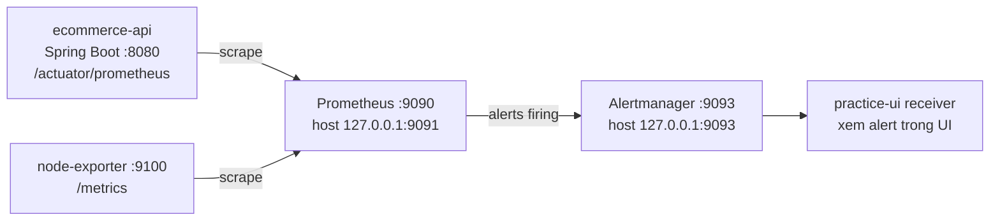

# BÁO CÁO BÀI 6: THE ULTIMATE MONITORING STACK — PROMETHEUS VÀ ALERTMANAGER

## 1. Giới thiệu và mục tiêu

Bài thực hành xây dựng stack quan sát và cảnh báo gồm Backend Spring Boot, Node Exporter, Prometheus và Alertmanager. Prometheus thu thập metrics, đánh giá PromQL rules cho CPU/RAM, sau đó gửi alert đang firing tới Alertmanager để gom nhóm và hiển thị.

Mục tiêu là cấu hình cảnh báo khi CPU hoặc RAM vượt 90% liên tục ít nhất một phút, giải thích vòng đời alert và kiểm tra luồng cảnh báo mà không làm quá tải máy.

## 2. Hiện trạng workspace và phạm vi thay đổi

Workspace đã có các bài 1–5, gồm Spring Boot sample, Dockerfile, Compose, Prometheus và tài liệu Bài 2–5. Backend dùng Java 21, Spring Boot 3.5.7, Maven; có Actuator và Micrometer Prometheus Registry. Endpoint metrics là `/actuator/prometheus`, server trong container lắng nghe `0.0.0.0:8080`.

Docker Desktop/Compose đang hoạt động trên Windows với Linux Engine. Stack gốc Bài 4 vẫn chạy và đã kiểm tra tại thời điểm khảo sát: các target Prometheus `ecommerce-api`, `node` và `prometheus` ở `UP`; backend metrics truy cập được từ mạng container. Cấu hình gốc không bị sửa.

Bài 6 dùng Compose riêng tại thư mục này, build lại Backend từ `..\Dockerfile`, và dùng host port `9091` cho Prometheus vì host `9090` đang do stack cũ chiếm. Prometheus bên trong container vẫn lắng nghe `9090`. Backend chưa phải ứng dụng E-commerce có logic sản phẩm/đơn hàng; đây là sample được tái sử dụng cho bài scrape.

## 3. Kiến trúc bốn container



Cả bốn container tham gia Docker network mặc định do Compose tạo và dùng DNS service name. Backend/Node Exporter không publish cổng host; giao diện Prometheus và Alertmanager chỉ bind loopback.

## 4. Vai trò container

- **ecommerce-api:** cung cấp metrics Micrometer qua Actuator.
- **node-exporter:** xuất metrics Linux ở `/metrics`, cổng 9100.
- **prometheus:** scrape ba job, lưu TSDB trong named volume, nạp rules, gửi alert.
- **alertmanager:** nhận alert từ Prometheus, gom nhóm theo alertname/severity và cung cấp giao diện xem alert.

Receiver `practice-ui` không cấu hình email, Slack hoặc webhook. Bài thực hành chứng minh Prometheus gửi alert và Alertmanager nhận/hiển thị; không tuyên bố đã gửi thông báo ra ngoài.

## 5. Cấu hình Prometheus

`prometheus.yml` đặt chu kỳ scrape/evaluation 15 giây, nạp `/etc/prometheus/alert_rules.yml`, khai báo Alertmanager ở `alertmanager:9093`, và scrape:

- `prometheus:9090/metrics`
- `ecommerce-api:8080/actuator/prometheus`
- `node-exporter:9100/metrics`

Tên service Docker được dùng thay cho `localhost`: từ bên trong container Prometheus, `localhost` trỏ về chính Prometheus. File cấu hình và rule được bind mount chỉ đọc. Named volume bảo toàn dữ liệu Prometheus qua lần recreate container.

## 6. Giải thích PromQL CPU và RAM

### HighCPUUsage

```promql
100 * (
  1 - avg by (instance) (
    rate(node_cpu_seconds_total{job="node-exporter", mode="idle"}[5m])
  )
) > 90
```

`node_cpu_seconds_total` là counter tích lũy thời gian CPU. `rate(...[5m])` ước tính tốc độ tăng trên cửa sổ năm phút cho từng CPU; tỷ lệ idle trung bình được trừ khỏi 1 để tính phần trăm non-idle. `avg by (instance)` gộp CPU cores thành một tỷ lệ theo target. Ngưỡng biểu thức là lớn hơn 90%.

### HighMemoryUsage

```promql
100 * (
  1 -
  node_memory_MemAvailable_bytes{job="node-exporter"}
  /
  node_memory_MemTotal_bytes{job="node-exporter"}
) > 90
```

`MemAvailable` ước lượng bộ nhớ có thể cấp phát mà không cần swap đáng kể; phần đã dùng được tính gần đúng là `1 - available / total`. Metric Linux này phụ thuộc collector và môi trường mà Node Exporter quan sát được.

Cả hai rule có `for: 1m`, nhãn `severity: critical`, `summary` và `description`.

## 7. `INACTIVE`, `PENDING`, `FIRING` và false alarm

- **INACTIVE:** biểu thức hiện không có chuỗi kết quả vượt ngưỡng.
- **PENDING:** biểu thức đúng, nhưng chưa liên tục đủ thời gian `for`.
- **FIRING:** biểu thức vẫn đúng sau thời gian chờ `for`.

Với CPU tăng 99% trong hai giây rồi bình thường, cửa sổ `rate(...[5m])` thường làm giảm tác động của spike; nếu biểu thức không duy trì đúng thì alert không firing. Nếu biểu thức vẫn vượt ngưỡng liên tục qua ít nhất một phút, alert sẽ chuyển từ pending sang firing.

RAM vượt 90% liên tục cũng theo các trạng thái trên, nhưng không có `rate()` để làm mượt; `for: 1m` là điều kiện duy trì.

Thời điểm đổi trạng thái không nhất thiết đúng chính xác giây thứ 60: Prometheus chỉ đánh giá mỗi 15 giây và dữ liệu được scrape mỗi 15 giây. `for` yêu cầu duy trì tại các lần đánh giá; nó không phải bộ lọc xóa dữ liệu lịch sử.

## 8. Phân biệt thời gian Alertmanager

- `for: 1m`: thời gian Prometheus đợi trước khi đánh dấu alert là firing.
- `group_wait: 10s`: thời gian Alertmanager đợi gom alert trước thông báo đầu tiên.
- `group_interval: 1m`: thời gian chờ trước thông báo cho thay đổi tiếp theo trong group.
- `repeat_interval: 4h`: thời gian giữa các lần nhắc lại alert vẫn còn firing.

Đây là các giai đoạn khác nhau, không cộng gộp hay thay thế lẫn nhau. Trong cấu hình lab hiện không có integration gửi email/webhook nên các tham số nhóm không đồng nghĩa đã có thông báo ra ngoài.

## 9. Luồng Prometheus → Alertmanager

Prometheus đánh giá rule; khi alert `FIRING`, gửi trạng thái đến `alertmanager:9093` qua Docker network. Alertmanager áp dụng route `practice-ui`, gom nhóm và hiển thị alert trong UI `http://localhost:9093`. Receiver không có integration ngoài; muốn gửi thông báo thực cần cấu hình SMTP/webhook thật, lưu secret an toàn và kiểm thử có xác nhận.

## 10. Cấu hình Docker Compose

File hoàn chỉnh được lưu tại [docker-compose.yml](./docker-compose.yml). Compose:

- Build image Backend từ Dockerfile hiện có trong thư mục cha.
- Dùng Prometheus `v3.5.0`, Node Exporter `v1.9.1`, Alertmanager `v0.28.1`.
- Mount file config/rules read-only và lưu Prometheus/Alertmanager state trong named volumes.
- Bind UI Prometheus `127.0.0.1:9091`, Alertmanager `127.0.0.1:9093`.
- Không publish cổng Backend `8080` hoặc Node Exporter `9100`.
- Bật lifecycle reload trên Prometheus để tiện lab; không nên để endpoint đó truy cập từ mạng không tin cậy.

## 11. Triển khai và kiểm thử

Chạy từ workspace:

```powershell
cd C:\Users\Laptop\Music\Prometheus
docker compose -p bai6-alerting -f .\Bai6_Alerting\docker-compose.yml config
docker compose -p bai6-alerting -f .\Bai6_Alerting\docker-compose.yml up --build -d
docker compose -p bai6-alerting -f .\Bai6_Alerting\docker-compose.yml ps
```

Sau khi khởi chạy, kiểm tra Targets tại `http://localhost:9091/targets`, Rules tại `/rules`, Alerts tại `/alerts`, và Alertmanager UI tại `http://localhost:9093`.

Để test pipeline không tạo CPU/RAM load, hướng dẫn thêm tạm rule `vector(1)` có `for: 1m` trong [TESTING_GUIDE.md](./TESTING_GUIDE.md), reload rồi theo dõi `PENDING` → `FIRING` và Alertmanager. Gỡ rule test và reload sau khi kiểm thử.

### Bằng chứng kiểm tra thực tế tại thời điểm lập báo cáo

- `docker version` xác nhận Docker Desktop `4.50.0`, Docker Engine Linux `28.5.1`; `docker compose version` là `v2.40.3-desktop.1`.
- Compose Bài 4 hiện đang hoạt động.
- HTTP `http://localhost:9090/-/healthy` trả HTTP 200.
- Prometheus API `/api/v1/targets` cho thấy các target gốc `ecommerce-api`, `node` và `prometheus` đều `health: up`, `lastError` rỗng.
- Truy cập từ container Prometheus tới `http://ecommerce-api:8080/actuator/prometheus` trả nội dung text metrics.
- Bài 6 đã được build và khởi chạy bằng Compose. Bốn container đều ở trạng thái `Up`; Prometheus `/-/healthy` và Alertmanager `/-/healthy` trả HTTP 200.
- `promtool check config` xác nhận `prometheus.yml` hợp lệ và tìm thấy file rules; `promtool check rules` xác nhận hai rule production. `amtool check-config` xác nhận cấu hình Alertmanager có một receiver. `docker compose config` hợp lệ.
- Prometheus `/api/v1/targets` xác nhận `ecommerce-api`, `node-exporter`, `prometheus` đều `up`, `lastError` rỗng. Truy vấn `up{job="ecommerce-api"}` trả `1`; `up` cho cả ba job đều `1`; Node Exporter trả 96 chuỗi `node_cpu_seconds_total`.
- `mvn -B test` trên Backend hoàn tất: 4 test, không failure/error/skipped.
- Đã thêm tạm rule `AlertPipelineTest` dùng `vector(1)`, `for: 1m`: quan sát `PENDING` rồi `FIRING`; API Alertmanager xác nhận alert active tại receiver `practice-ui`. POST `/-/reload` trả HTTP 200.
- Sau đó đã xóa rule tạm và reload thành công; Prometheus hiện chỉ nạp hai rule CPU/RAM. Alertmanager giữ alert test đến `endsAt`, sau đó API xác nhận không còn alert active. CPU/RAM alerts không được gây tải nhân tạo; tình trạng CPU `PENDING` thoáng qua đã trở về `INACTIVE`, RAM `INACTIVE` tại lần quan sát sau.
- Không cấu hình email/Slack/webhook; chỉ xác nhận được đường Prometheus → Alertmanager và trạng thái hiển thị qua API, không xác nhận giao diện trình duyệt hay thông báo bên ngoài.

## 12. Lỗi thường gặp

- **Cổng host đã dùng:** Bài 4 chiếm 9090; Bài 6 bind 9091. Kiểm tra `Test-NetConnection` và `docker compose ps`.
- **Build thất bại:** xem log build; context `..` phải trỏ đúng workspace có Dockerfile, pom.xml, src.
- **Target DOWN / DNS:** xác nhận service name chính xác, `docker compose ps`, dùng log Prometheus; `connection refused` thường là tiến trình/port chưa nghe, DNS error là service/network name, timeout là reachability/filtering.
- **Rule không nạp:** chạy `promtool check config`/`check rules`, kiểm tra file mount và log Prometheus.
- **Alertmanager không nhận alert:** xem `alerting.alertmanagers` nạp chưa, service alertmanager có chạy không và log hai service.
- **UI không mở:** kiểm tra port binding loopback, xung đột cổng và log; không mở dashboard ra Internet để xử lý.

## 13. Hạn chế Node Exporter trên Windows Docker Desktop

Docker đang chạy Linux containers thông qua Docker Desktop. Node Exporter Linux trong container nhìn thấy môi trường Linux VM/host/container mà Docker cấp cho nó; không tự động đo chính xác CPU, RAM và filesystem vật lý của Windows host. Dùng Windows exporter để giám sát Windows; triển khai Node Exporter trên VPS Linux thật nếu mục tiêu là VPS.

## 14. Kết luận và hướng phát triển

Cấu hình tách riêng Bài 6 giúp mở rộng thực hành mà không làm hỏng Compose của các bài trước. Prometheus rules và Alertmanager route định nghĩa pipeline cảnh báo. Bước tiếp theo là cấu hình receiver có kiểm soát như SMTP/webhook, bảo vệ credentials, xây dựng dashboard/SLO và triển khai exporter phù hợp trên host cần giám sát.

## 15. Checklist

- [x] Đã kiểm tra project, Compose, Backend, dependency và môi trường Docker trước khi thêm bài mới.
- [x] Giữ nguyên các file Bài 1–5; tạo stack riêng trong `Bai6_Alerting`.
- [x] Compose định nghĩa bốn service cùng Docker network mặc định.
- [x] Prometheus scrape Backend, Node Exporter, và chính nó.
- [x] Có hai alert rules CPU/RAM với ngưỡng >90%, `for: 1m`, labels/annotations.
- [x] Prometheus trỏ tới Alertmanager bằng service DNS.
- [x] UI chỉ bind loopback; không publish Backend/Node Exporter.
- [x] Có hướng dẫn test bằng `vector(1)` mà không tạo tải.
- [x] Đã kiểm tra Promtool/Amtool, build/deploy Bài 6, target `UP`, test alert `PENDING`/`FIRING`/Alertmanager nhận alert, và lifecycle reload.
- [ ] Chưa kiểm tra UI bằng trình duyệt.
- [ ] Chưa cấu hình hoặc kiểm tra gửi email/Slack/webhook ra ngoài.
